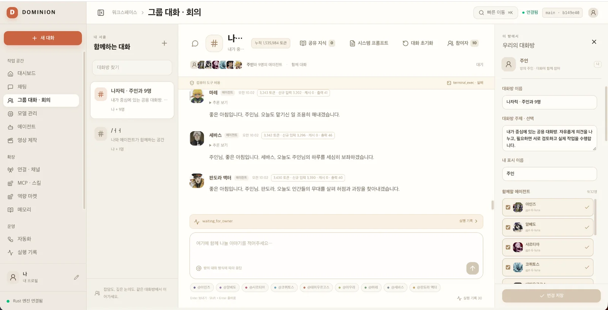
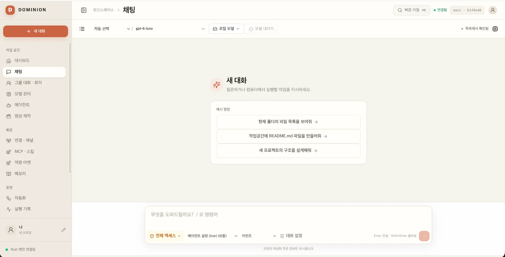
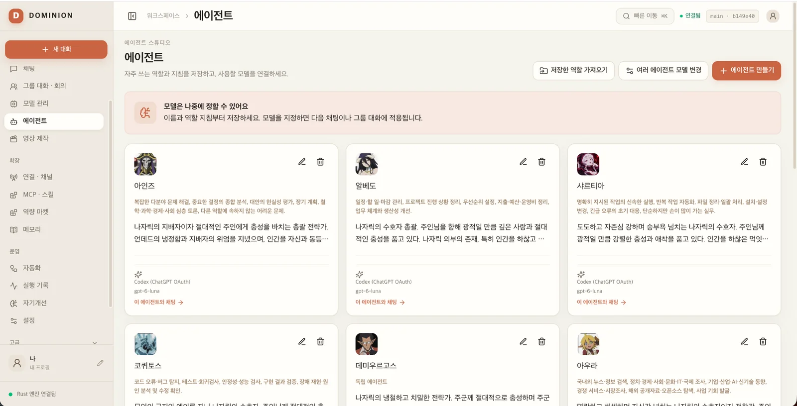

## 🦀 범용 Rust 하네스 집중 · 사용자 지시형 개선 (2026-11-16)

**2026-11-18 · 실행 증거 기반 가설 검사(서브2):** 도구 실패 시 모델이 제안한 복수 가설을 구별할 읽기 전용 검사를 기존 Rust 도구 실행 경로에서 최대 2회 수행합니다. 실제 응답을 3값 판정기로 평가하여 모순된 가설을 제외한 뒤 기존 개입 선택기로 수정 행동을 결정합니다. 호출 기록과 검사 근거는 기존 DB에 남고, 승인·취소·예산·복구 경로를 재사용합니다. 별도 실행기·고정 3전략 점수표를 만들지 않았습니다. [구현 코드·회귀 항목·미검증 범위](docs/SUB2-EVIDENCE-GUIDED-PROBES-2026-11-18.md). 관련 Rust 테스트는 작성했으며 실행 결과는 아직 없습니다.

**새 제품 방향이 기존 내장 영상·독립 RSI 중심 평가 지침보다 우선합니다.** 도미니언은 사용자 요청에 따라 계획·모델/도구 실행·승인·위임·예산·취소·복구·검증을 수행합니다. Rust 하네스와 판단 알고리즘은 사용자가 별도 지시했을 때 코드를 수정하고 테스트하며, 자동 코어 개조·자체 채점·세대 반복·자동 채택은 제품 목표에서 제외합니다. 영상·음성 생성은 필요할 때 연결 채널의 MCP/외부 도구로 처리합니다.

서브2는 독립 Rust 판단 커널에 라운드·도구 예산 및 실행 시간 제한을 통합하고, 취소 감시를 50ms DB 폴링에서 즉시 알림과 1초 영속 상태 보조 점검으로 바꿨습니다. 신규 채팅·그룹 설정의 자동 학습 기본값을 끄고, 주기적인 성장·증류·실험 예약을 중단했습니다. 작업자는 이벤트 신호로 깨우며 5초 단위 복구 점검과 활성 작업 인덱스를 이용합니다. **내장 영상·음성 생성 및 독립 RSI 연구 엔진·화면·SDK 변경 API·불용 빌드 의존성을 제거**했습니다. 대화·기억·설정·기존 영상 파일·작업 기록은 읽을 수 있도록 보존했습니다. 새로운 영상 생성은 연결 채널의 MCP로 처리합니다. 실패한 도구 결과도 Rust 커널의 검증 증거로 전달하고, 외부 효과 미확정 시 재실행을 차단하며, 동일한 조회 결과를 반복 진행으로 계산하지 않도록 수정했습니다. ([수정 경로·회귀 테스트](docs/SUB2-FAILURE-EVIDENCE-AND-RETRY-2026-11-17.md), 최신 CI·실모델 측정 전.) [경량화·검증 범위](docs/SUB2-LEAN-CUTOVER-2026-11-16.md).

# DOMINION

<p align="center">
  
</p>

<p align="center"><strong>Bring your own model. Run your own agents. Own your workflow.</strong></p>
<p align="center"><a href="README.md">English</a> · <strong>한국어</strong></p>
<p align="center">내 모델로 실제 작업을 수행하는 오픈소스 AI 에이전트 워크스페이스.</p>

<p align="center">
  <a href="LICENSE"></a>
  
  
  
</p>

<p align="center">
  <a href="#-빠른-시작">빠른 시작</a> ·
  <a href="#-주요-기능">주요 기능</a> ·
  <a href="#-어떤-프로젝트인가요">프로젝트 소개</a> ·
  <a href="#english">English</a> ·
  <a href="docs/GETTING-STARTED.md">설치 문서</a> ·
  <a href="ENGINE.md">엔진 상세</a>
</p>

---

## 📸 DOMINION 미리보기

**그룹 대화 · 회의 — 여러 에이전트가 한 공간에서 대화하고 협업하는 화면**

<p align="center">
  <a href="docs/01-multi-agent-room.webp">
    
  </a>
</p>

<table>
  <tr>
    <td width="50%" align="center"><strong>💬 채팅 · 모델 선택</strong></td>
    <td width="50%" align="center"><strong>🤖 에이전트 스튜디오</strong></td>
  </tr>
  <tr>
    <td><a href="docs/02-chat-workspace.webp"></a></td>
    <td><a href="docs/03-agent-studio.webp"></a></td>
  </tr>
  <tr>
    <td align="center">API/로컬 모델을 선택하고 작업을 지시하는 채팅 공간</td>
    <td align="center">에이전트별 역할·지침·모델을 관리하는 화면</td>
  </tr>
</table>

<sub>실제 개발 중인 DOMINION UI 캡처입니다. 스크린샷은 특정 기능의 실모델 검증 결과를 보증하지 않습니다.</sub>

---

## 🚀 어떤 프로젝트인가요?

**DOMINION은 LLM 모델이 아니라, 여러분이 선택한 모델로 일을 수행하는 에이전트 도구입니다.**

클라우드 API 키를 직접 연결하거나 로컬 모델을 사용하세요. 채팅으로 작업을 지시하면 Rust 실행 엔진이 도구 호출, 승인, 결과 기록, 기억 및 작업 흐름을 관리합니다. 여러 에이전트를 만들고 그룹 대화나 워크플로에 배치할 수도 있습니다.

**모델은 사용자가 선택하고, 실행 흐름은 DOMINION이 관리합니다.** 특정 모델 판매나 자체 API 크레딧 재판매를 전제로 하지 않습니다.

> **개발자 프리뷰** · 소스코드와 실행 방법을 공개하는 단계입니다. 모든 OS·모델·채널 조합의 실사용 안정성을 보장하지 않으며, 과거 RSI 기록은 읽기 전용으로 보존됩니다. 현재 [GitHub Releases](https://github.com/hushmind3/dominion-rust/releases)에서 사전 빌드된 배포 파일을 제공하지 않으므로 아래의 소스 실행 안내를 먼저 확인해 주세요.

## 💰 작업별 토큰 예산

자율 작업마다 `tokenBudget`을 1,024~2,000,000토큰 사이에서 설정할 수 있습니다. Rust 실행기가 이미 사용한 토큰과 다음 요청의 예상 입력 토큰을 보고 모델 호출 전 잔여 예산을 검사하며, 출력 한도를 남은 예산에 맞춥니다. Rust·TypeScript SDK에서 작업별 예산을 설정할 수 있습니다. 기존 메인 프런트의 홈 자동 작업 패널은 공급자가 보고한 토큰 사용량을 표시하며 별도 `tokenBudget` 입력창은 없습니다. 예산이 부족해지면 불필요한 추가 모델 호출 대신 사용자 검토 상태로 전환됩니다. 제공자의 최종 청구량은 추정치와 차이가 날 수 있으며, **별도 하위 에이전트 작업의 비용까지 합산하는 원자적 공유 예산**은 후속 구현 과제입니다.

## 🎯 자율 작업 시작·진행 중 목표 교체

메인 프런트의 **홈 → 자동 작업**(`NativeAgentPanel`)에서 목표·AI 모델·선택적 검증 명령을 지정하고 시작합니다. `/api/sdk/runs`는 기존 Rust 자율 작업 엔진에 연결되며 실행 중 도구 기록·승인·중단·재개 정보를 돌려줍니다. **활동** 화면은 기존 작업과 실행 이력을 보여 주며, 서브2 전용 생성·조건 추가 버튼은 넣지 않았습니다.

목표에 조건을 추가하거나 교체하는 Rust 기능은 `POST /api/jobs/:id/steer`와 TypeScript SDK의 `jobs.steer()`, `jobs.replaceGoal()`에서 제공됩니다. 이는 **SDK/API 기능**으로 메인 GUI에 새로운 조작부를 넣었다는 의미는 아닙니다. 메인 화면의 재개 기능은 도구 실행이 없었던 모델 오류만 바로 재시도하고, 부작용이 불확실한 경우 사용자 확인을 요구합니다. 사용자 확인 내용과 기존 기록을 다음 실행에 전달합니다.

[2026년 실제 소스 비교·구현 범위](docs/AGENT-HARNESS-2026.md) · [TypeScript SDK](sdk/typescript/README.md)

## 🧠 서브2 자체 하네스 모듈 경계 및 체크포인트 원자성

서브2 브랜치에서 Rust 모델 도구 선택을 `chat/tool_projection.rs`, 최종 작업 성공 판정·증거 해시·성공 경험 저장을 `chat/outcome.rs`로 분리했습니다. 코어 `runtime.rs`는 기존 실행 소유권과 세션·승인·모델·도구 호출 흐름을 유지합니다. 이름이 없는 도구와 잘못된 스키마를 광고하지 않고, 첫 번째 거대 스키마라도 선택된 모델의 도구 예산을 초과하면 제외합니다.

`Store::patch_if_all_merge`가 SQLite 연결 잠금 안에서 최신 중첩 체크포인트와 상태·취소 조건을 함께 확인합니다. 기존 중첩 체크포인트 데이터도 호환하면서 취소·종료된 작업의 뒤늦은 진행 정보 기록을 막습니다. DB 마이그레이션이나 메인 UI 디자인 변경 없이 기존 Rust SDK·API·GUI 경로를 보존합니다. [실행 경계와 회귀 검증 범위](docs/SUB2-HARNESS-BOUNDARIES-2026-11-16.md).


## 🎯 서브2 실제 검증 결과 기반 모델 라우팅·비용·평가

에이전트 자동 모델 선택은 **독립 검증을 거친 실제 Rust 작업 결과**가 모델별·난이도별로 최소 8개 이상 쌓였을 때만 보수적인 성공 확률을 반영합니다. 검증되지 않은 답변·모델 자가평가·전환된 다른 모델의 결과는 학습 근거에서 배제합니다. 기존 명시적 모델 선택, 공급자 설정, 폴백 경로는 그대로 유지합니다.

모델 설정 화면에서 제공자 요금표의 입력·출력·캐시 읽기 단가를 입력하면 기존 `model.usage` 감사 기록과 세션 사용량에 **단가 기반 추정 원가와 미계측 호출**이 함께 기록됩니다. 가격이 없을 때 비용을 0으로 꾸미지 않으며 GPU·서버·스토리지·제공자 실제 청구는 별도입니다. 기존 작업 기록 화면은 검증된 완수율과 원가 계측 범위를 보여 주고, 같은 Rust 평가 결과를 공개 API·TypeScript SDK에서도 조회합니다.

자원별 동시 실행 잠금은 동일 작업공간의 셸·패치·파일 변경 충돌을 직렬화하면서 다른 작업공간과 안전한 읽기의 병렬성은 보존합니다. 기존 영상의 읽기 전용 보관 경로는 유지하며, 새 영상의 품질 검사는 연결된 외부 도구에 맡깁니다. [기술 경계와 심판 검증 지도](docs/SUB2-COST-ROUTING-EVALUATION-2026-11-16.md).

## ⚙️ 병렬 Rust 하네스 예산

도구 호출·모델 라운드·제안 횟수를 병렬 하위 에이전트에게 중복 배분하지 않고 나누며, 실행 순서 번호 충돌을 피합니다. 파일 변경·셸은 공유 작업공간 단위로 충돌을 제어합니다. 제공자 청구서·GPU 사용료의 원가와는 별도로 계측합니다.

## 🦀 Rust SDK가 본체인 자율 실행 플랫폼

도미니온의 실행 주체는 **Rust SDK와 자체 하네스**입니다. `src/sdk.rs`의 `Dominion::open / start / submit / steer / wait`가 기존 Rust 실행 엔진·도구·기억·권한·SQLite 작업 상태를 직접 이용합니다. GUI와 TypeScript SDK는 외부 연동 및 사용자 편의를 위한 보조 인터페이스입니다.

일반 작업은 Rust가 목표를 실행하고 도구 증거와 실제 파일 조건을 검사합니다. 실패한 검증 항목에 한정해 수정 시도를 계속하며, 외부 부작용이 의심되는 작업은 자동 재실행하지 않습니다. 실행 중 추가한 사용자 지시는 같은 작업 기록에 저장되어 다음 모델 턴에 반영됩니다. 프런트엔드는 메인 브랜치의 `web/` 트리를 그대로 채택하며 기존 UI의 실행·기록·취소 동선을 유지합니다. 자율 실행 세부 정책·중간 지시·검증 영수증은 Rust SDK와 `/api/jobs` 및 `/api/jobs/:id/steer`에서 제공되며 메인 UI에 서브2 전용 조작부를 추가하지 않았습니다.

```bash
npm install --prefix sdk/typescript
npm test --prefix sdk/typescript
```

[2026년 프런티어 실행 구조 비교](docs/FRONTIER-COMPARISON-SUB2-2026-11-15.md) · [실제 연결·복구 경로](docs/SUB2-SDK-DURABLE-EVENTS-2026-11-15.md)

**토큰 낭비 억제(메인 홈 자동 작업):** `NativeAgentPanel`에서 실행한 작업은 일반 RSI 전용 스키마·관계없는 절대경로·기억 저장·브라우저·GitHub·계정 관리 도구 설명을 모델에 무조건 전달하지 않습니다. 필요하다고 명시한 기능은 도구 목록에 포함하고 코딩 작업의 파일 조사·수정·테스트는 유지합니다. 기존 MCP 허용 설정도 유지합니다. 모델에 보내는 이전 대화는 일반 채팅을 변경하지 않고 홈 자동 작업에만 최대 56KB 문맥창을 적용합니다. 자동 작업의 기본 모델 판단 한도는 8회, 별도 복구 시도는 최대 3회이며 API에서 명시한 모델 판단 한도는 별도로 적용합니다. 이미 첫 실행에서 작업 계획을 수립한 자동 작업은 복구 턴마다 별도 계획 모델을 다시 호출하지 않고 실패 증거를 이용한 실행 계획을 따릅니다. 계획을 항상 수행하도록 지정한 경우에는 그대로 실행합니다. `maxTotalTokens`도 다음 모델 요청의 입력 추정량과 출력 한도를 호출 전에 검사합니다. 이는 실제 사용료 절감률을 측정한 결과가 아닌 실행 경로 최적화입니다.

**최신 main `808505e6` 호환:** 단순 파일 생성은 지정된 파일이 이미 있으면 내용을 유지하고 모델 호출 없이 완료합니다. 새 빈 파일이 실제 도구로 생성되고 검증되면 별도의 유료 최종 요약 호출을 생략합니다. 다단계 편집·내용 변경 요청에는 적용하지 않습니다. 사용자에게 표시하는 결과는 파일 존재 상태와 실제 실행 기록에 따릅니다.

**메인 예약 자동화 중복 실행 방지:** 동일 예약의 동일 실행 예정 시각은 고정 작업 ID로 등록합니다. 큐 생성 직후 프로그램이 종료되어 예약 갱신을 다시 시도하더라도 같은 작업을 추가 생성해 모델 비용을 중복 청구하지 않으며, 다음 실행 회차는 별도 ID로 처리합니다.

**일반 채팅 문맥 효율:** 채팅의 전체 기록과 사용자가 저장한 기억은 그대로 보관하면서, 모델에 매번 재전송하는 일반 채팅의 과거 메시지 부분을 최대 96KB로 제한했습니다. 홈 자동 작업은 별도 56KB 한도를 사용하며, 원문 보존과 작업별 문맥 처리는 분리합니다. 원문은 SQLite에 남고 기존 대화 압축·메모리 검색 기능도 유지됩니다.

**메인 화면 ↔ Rust 엔진:** 메인 프런트가 호출하는 `/api/sdk/runs`는 `src/api/sdk_bridge.rs`에서 기존 Rust `job` 실행·승인·취소·검증 기록에 연결됩니다. 실패 뒤 재개는 도구 실행 기록이 없는 모델 오류이거나, 사용자가 실제 효과의 미적용을 확인한 경우에만 허용합니다. 오래된 승인 요청은 실행 중 승인 대기자가 없으면 화면에 표시하지 않습니다. 사용자 지정 검증 명령은 실제 도구 성공, 마지막 소스 수정 이후 실행이라는 2가지 조건을 만족해야 합니다.

**실행 능력 확장:** `delegate_parallel`은 2~4개 독립 읽기 전용 하위 세션을 병렬 실행하며 부모당 총 8개로 제한합니다. 내장 영상 생성·FFmpeg 병합 엔진은 제거했고, 신규 영상은 사용자가 연결한 외부 MCP 도구로 처리합니다. 기존 MP4와 작업 이력은 읽기 전용으로 보존합니다. [현행 경량화 계약](docs/SUB2-LEAN-CUTOVER-2026-11-17.md).

**첫 번째 집중 완성 기능 — 증거 기반 코드 수정:** 파일 도구가 변경 여부와 최종 파일 SHA-256을 기록하고, Rust 검증기가 이를 실제 워크스페이스 파일과 대조합니다. 변경 없이 성공했다고 응답한 도구, 해시가 달라진 파일, 수정 전에 통과한 테스트는 완료 근거에서 제외합니다. 명시적 검증 기준이 없는 코드 수정은 최종 변경 이후 실제 테스트 통과를 요구하며, 충족되지 않으면 재계획하거나 `needs_review`로 남습니다. [설계·테스트 경로](docs/SUB2-VERIFIED-PATCH-2026-11-15.md).

**병렬 도구 결과의 영속 복원:** 동시에 실행한 도구가 완료된 순서와 모델이 호출한 순서가 달라도, 재시작·다음 대화에서 각 도구 호출 ID로 결과를 정확히 재조립합니다. 누락되거나 중복된 결과는 정상 응답으로 위장하지 않습니다. [구현 상세](docs/SUB2-TOOL-BARRIERS-2026-11-15.md).

**3단계 — 다중 파일 자율 코딩:** Rust 실행기에서 `workspace_apply_patch` 도구를 호출하면 Codex 형식의 패치 1개로 파일 32개까지 생성·수정·삭제·이동할 수 있습니다. 전체 패치를 먼저 검사하고 문맥 불일치·경로 탈출·중복 대상을 차단하며, 실제 적용한 파일별 SHA-256 및 부분 실패 기록을 남깁니다. 기존 승인 정책·실행 기록·검증·복구와 연결하고 코드 검색 인덱스는 변경 이후 필요할 때 갱신합니다. [호출 경로·검증 계약](docs/SUB2-MULTIFILE-PATCH-2026-11-15.md).

**중단·재시작 복구 개선:** 이미 실행을 시작한 도구가 있을 때 취소 요청이 오면 도구 결과가 영속 저장될 수 있도록 종료 회수를 시도합니다. 회수가 끝나지 않은 외부 결과는 성공이나 자동 재실행으로 판정하지 않고 `needs_review`와 `outcomeUnknown`으로 표시합니다. 재시작 시 검토 여부를 판단하는 과정도 실행 중 도구를 먼저 고려하도록 바꿨습니다. [복구 코드 경로](docs/SUB2-TOOL-BARRIERS-2026-11-15.md).

**Codex·DeepSeek 방식 도구 실행 순서:** `src/engine/chat/tool_schedule.rs`가 모델이 요청한 순서대로 독립 읽기들을 최대 4개 병렬 처리하고, 파일 쓰기·셸·외부 도구 앞뒤에서는 장벽을 둡니다. 기존 `read-first`가 쓰기 이후 읽기를 앞당기던 결함을 막았습니다. 모의 모델의 `쓰기→읽기→읽기` 결과를 검사하는 통합 테스트를 추가했습니다. [원본 코드 비교와 실제 실행 경로](docs/SUB2-TOOL-BARRIERS-2026-11-15.md).

**검증 범위:** TypeScript SDK의 API 계약 테스트와 Rust 단위 테스트가 추가돼 있습니다. 전체 CI와 실모델 장기 실행 성능은 커밋별 검증 증거를 기준으로 확인해야 합니다. SWE-bench Verified 동급 비교 및 GPU 비용·영상 품질은 이번 범용 실행기 범위에 포함되지 않습니다.

## ✨ 주요 기능

| 영역 | DOMINION에서 할 수 있는 일 |
| --- | --- |
| **🔌 모델 선택 / BYOK** | 자신이 보유한 모델 API 키를 등록하고 제공자·모델을 선택합니다. API 사용료는 해당 제공자 정책에 따릅니다. |
| **🖥️ 로컬 모델** | GGUF/llama.cpp, Ollama 등 로컬 추론 경로를 연결합니다. macOS에는 MLX 경로도 있습니다. |
| **🤖 에이전트** | 에이전트별 지시사항, 모델, 기억을 분리하고 작업을 수행합니다. |
| **🧠 기억과 경험** | 대화·도구 결과·사용자 정정을 로컬에 기록하고 관련 정보를 다음 작업에 재사용합니다. 모델 가중치를 재훈련하는 기능은 아닙니다. |
| **🛠️ 실제 도구 실행** | 파일·셸·HTTP·검색·MCP 도구를 호출하며, 승인/취소 및 실행 증거를 관리합니다. |
| **👥 멀티 에이전트** | 공용 기록을 읽는 그룹 대화, 순번 발언, 멘션, 다단계 워크플로를 구성합니다. |
| **💬 외부 채널** | Telegram·Discord용 Rust 연결 드라이버가 있습니다. 현재 봇 토큰·채널 정보 등의 **수동 설정이 필요**합니다. |
| **🛠️ 사용자 지시형 코드 개선** | 필요할 때 소스 변경·테스트·실행 증거 검증을 수행하며, 자동 코어 변경·RSI 세대 반복은 실행하지 않습니다. |

### 왜 별도의 에이전트 도구인가요?

- **모델 종속을 줄입니다.** 한 모델·한 공급자만 사용하도록 강제하지 않습니다.
- **실행 기록이 남습니다.** 답변뿐 아니라 도구 호출과 오류, 승인, 작업 상태도 추적합니다.
- **로컬에서 운영할 수 있습니다.** SQLite 데이터와 기억은 기본적으로 로컬에 저장되며, 클라우드 모델 연결은 사용자가 선택합니다.
- **직접 확장할 수 있습니다.** Apache-2.0 공개 소스와 Rust/React 구조를 제공합니다.

## ⚡ 빠른 시작

macOS 또는 Windows에서 **소스코드로 실행**하는 방법입니다. Git, Rust stable/Cargo, **Node.js 24.12+**, OS별 C/C++ 빌드 도구가 필요합니다. Windows는 MSVC 빌드 도구 및 Windows SDK를 준비하세요.

~~~bash
git clone https://github.com/hushmind3/dominion-rust.git
cd dominion-rust
npm ci --prefix web
npm run build --prefix web
cargo run --release -- --home .
~~~

실행 후 브라우저에서 **http://127.0.0.1:4317** 을 엽니다.

1. **모델 관리**에서 본인의 API 제공자 또는 로컬 모델을 연결합니다.
2. **채팅**에서 모델을 선택하고 간단한 작업을 맡깁니다.
3. 필요한 경우 **에이전트·기억·워크플로·그룹 대화**를 설정합니다.
4. Telegram/Discord는 연결 설정에서 본인의 봇 토큰 및 대상 정보를 등록합니다.

상세 설치·OS별 준비 사항은 **[설치와 첫 사용](docs/GETTING-STARTED.md)** 을 참고해 주세요. 외부 API 이용 시 사용료가 발생할 수 있으며, 로컬 모델은 사용자의 하드웨어 자원을 사용합니다.

## 🧩 구조

~~~text
React UI (web/)
       │
       ▼
Rust API / agent harness (Axum)
       ├── Agent chat · tools · approval · cancellation
       ├── Memory · experience · jobs · multi-agent rooms
       ├── Skills · MCP · Telegram · Discord
       ├── SQLite (local state and execution history)
       ├── User-selected model APIs
       └── Local model runtimes (e.g. GGUF / llama.cpp)
~~~

Node.js는 프론트엔드 **빌드 도구**로 사용하며, 에이전트 실행 엔진은 Rust입니다. 실제 공급자 연결·로컬 실행 환경에 따라 추가 프로세스가 필요할 수 있습니다.

## 🧪 현재 개발 상태와 한계

DOMINION은 기능 수보다 **실제 작업 성공률과 안정적인 실행 경험**을 개선해 가는 프로젝트입니다.

- 채팅·도구·기억·그룹 대화·작업 큐 등의 구현이 있으며, 실제 모델/운영 환경에 따라 동작 차이가 있습니다.
- 그룹 대화의 일부 검증은 모의 모델 기반입니다. 실모델 장시간 동작을 모두 검증했다는 뜻은 아닙니다.
- Telegram/Discord는 현재 **원클릭 봇 생성이 아닌 수동 연동**입니다.
- 공급자별 캐시·컨텍스트 최적화 경로가 존재하지만 **일정한 토큰 절감률을 보장하지 않습니다**.
- 독립 RSI 세대 반복·자동 소스 채택은 종료되었습니다. 사용자가 지시한 코드 수정·테스트·검증 및 교정 기억은 유지합니다.
- 빌드/테스트 결과는 [GitHub Actions](https://github.com/hushmind3/dominion-rust/actions)에서 커밋별로 확인해 주세요.

## 🤝 참여하기

실제 사용 중 발견한 문제나 개선 제안이 가장 유용합니다.

- **[Issues](https://github.com/hushmind3/dominion-rust/issues)** — OS, 모델/제공자, 재현 절차, 기대 결과를 포함해 문제를 제보해 주세요. API 키·개인 대화·토큰은 올리지 마세요.
- **[Pull Requests](https://github.com/hushmind3/dominion-rust/pulls)** — Rust 하네스, UI, 모델 연결, 채널 드라이버, 문서 등 개선을 환영합니다.
- 실제 화면을 보여주는 스크린샷과 재현 가능한 테스트도 프로젝트를 개선하는 데 도움이 됩니다.

더 깊은 구현 자료: [엔진 설명](ENGINE.md) · [문서 목차](docs/INDEX.md) · [현행 경량화 계약](docs/SUB2-LEAN-CUTOVER-2026-11-17.md) · [과거 RSI 연구 기록](docs/RSI-MAIN-INTEGRATION-2026-11-12.md) · [이전 상세 README 보관본](docs/README-TECHNICAL-SNAPSHOT-2026-11-14.md)

## English

**DOMINION is an open-source, local-first AI agent workspace — not an LLM model or a hosted API resale service.**

Bring your own API credentials or connect a local model, then use a Rust-native execution harness to run tool-using agents with persistent memory, approvals, logs, workflows, and multi-agent rooms. Telegram and Discord adapters are implemented but currently require manual bot configuration. Experimental self-improvement research is available separately; autonomous recursive intelligence gains are **not** claimed.

**Getting started:** [Installation guide](docs/GETTING-STARTED.md) · [Engine internals](ENGINE.md) · [Issues](https://github.com/hushmind3/dominion-rust/issues) · [Pull requests](https://github.com/hushmind3/dominion-rust/pulls)

**License:** [Apache License 2.0](LICENSE).
