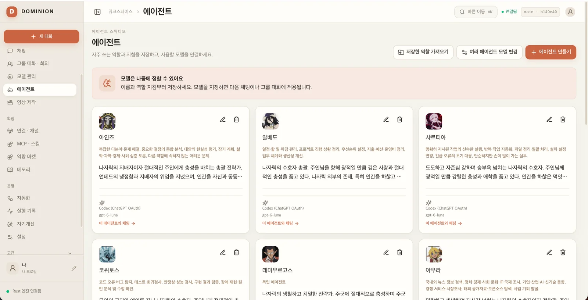

# DOMINION

<p align="center">
  
</p>

<h3 align="center">Bring your own model. Run your own agents. Own your workflow.</h3>

<p align="center">
  <strong>An open-source, local-first AI agent workspace powered by a native Rust execution engine.</strong><br/>
  Connect your own cloud or local LLMs. Run tool-using agents, collaborate across multiple agents, generate videos, and explore experimental recursive self-improvement.
</p>

<p align="center">
  <a href="README.md"><strong>English</strong></a> · <a href="README.ko.md">한국어</a>
</p>

<p align="center">
  <a href="LICENSE"></a>
  
  
  
  <a href="https://github.com/hushmind3/dominion-rust/actions"></a>
</p>

<p align="center">
  <a href="#-screenshots">Screenshots</a> ·
  <a href="#-what-you-can-do">Features</a> ·
  <a href="#-quick-start">Quick start</a> ·
  <a href="#-architecture">Architecture</a> ·
  <a href="https://github.com/hushmind3/dominion-rust/discussions">Discussions</a> ·
  <a href="#-contributing">Contribute</a>
</p>

---

## What is DOMINION?

RSI experimental adoption is bound to frozen paired evaluation. The evaluator records the candidate's pre-oracle Git tree and checks it against adopted descendants. Each system-evolution generation also verifies its spawned executable hash and controller identity before candidate promotion. Rust independently reconstructs the frozen candidate's Git tree before launching the paired evaluator; details are in [the Sub2 tree-proof note](docs/SUB2-RSI-TREE-PROOF-2026-11-15.md) and [the spawned-worker note](docs/SUB2-RSI-DESCENDANT-2026-11-15.md). In automatic system evolution, the rebuilt descendant may select a measured A→B→A return experiment from independently verified history, with an immutable coordinator guard and [an explicit cross-domain audit](docs/SUB2-RSI-CROSS-DOMAIN-2026-11-15.md).


**DOMINION is an AI agent tool, not another AI model or a token-reselling service.**

Connect a model you already have access to — including supported cloud APIs and locally hosted models — and use it inside an agent workspace. DOMINION's Rust harness handles tool execution, permissions, durable tasks, long-term memory, and multi-agent coordination. The workspace also includes AI video generation workflows and experimental recursive self-improvement (RSI).

You choose the models. You control the credentials. You run the workspace.

**Designed for developers, local-LLM enthusiasts, and people who want to experiment with their own autonomous workflows.**

## 📸 Screenshots

**Multi-agent room — agents sharing a conversation, with participant and room controls**

<p align="center">
  <a href="docs/01-multi-agent-room.webp">
    
  </a>
</p>

<table>
  <tr>
    <td align="center" width="50%"><strong>Chat workspace</strong></td>
    <td align="center" width="50%"><strong>Agent studio</strong></td>
  </tr>
  <tr>
    <td><a href="docs/02-chat-workspace.webp"></a></td>
    <td><a href="docs/03-agent-studio.webp"></a></td>
  </tr>
  <tr>
    <td align="center">Choose a model and give it a task.</td>
    <td align="center">Configure independent agents and roles.</td>
  </tr>
</table>

<sub>Real development-build screenshots with Korean UI labels. English and Korean UI translation files are included in the project. Screenshots show interfaces, not claims of comprehensive real-model reliability.</sub>

## ✨ What you can do

| Feature | Description |
| --- | --- |
| **Your models, your keys** | Register supported API providers with your own credentials. No DOMINION-hosted token subscription required. |
| **Local LLMs** | Connect local inference with GGUF/llama.cpp or Ollama; a macOS MLX path is also available. |
| **Tool-using agents** | Work with files, shell commands, HTTP/search tools, skills, and MCP integrations, subject to execution policies. |
| **Persistent memory** | Store conversation context, verified experience, corrections, and execution history locally. |
| **Multi-agent rooms** | Give agents separate roles, run shared discussions, and coordinate workflows with multiple participants. |
| **Durable jobs** | Track tasks, approvals, execution evidence, cancellation, and recovery in SQLite. |
| **AI video creation** | A dedicated video workspace for prompt-based generation jobs with native/ComfyUI backends, output management, and YouTube upload integration. Requires appropriate local backends and account setup. |
| **Messaging channels** | Native Telegram and Discord adapters; currently require bot credentials and manual configuration. |
| **Recursive self-improvement (RSI) research** | Experiment with source-editing campaigns, independent evaluations, candidate selection, evidence records, and controlled adoption. This does **not** claim proven general recursive intelligence gains. |

### Why a separate agent workspace?

- **Model flexibility:** use supported cloud models or run locally without locking the entire workflow to one provider.
- **Execution you can inspect:** tasks have tool calls, outcomes, approvals, and error records, not just chat messages.
- **Local-first state:** SQLite stores agent data and history locally by default.
- **Open code:** inspect and extend a Rust engine with a React UI under the Apache-2.0 license.

## ⚡ Quick start

**Source build for macOS and Windows.** Install Git, Rust stable/Cargo, Node.js **24.12+**, and your OS's C/C++ build prerequisites. On Windows, you will also need the MSVC build tools and Windows SDK.

```bash
git clone https://github.com/hushmind3/dominion-rust.git
cd dominion-rust
npm ci --prefix web
npm run build --prefix web
cargo run --release -- --home .
```

Open **http://127.0.0.1:4317** in your browser.

1. Add your own API provider, or configure a compatible local-model runtime in **Models**.
2. Select a model in **Chat** and try a task.
3. Explore **Agents**, **Multi-Agent Rooms**, **Memory**, **Workflows**, **Video**, **Self-Improvement**, and **MCP / Skills**.
4. To use Telegram or Discord, configure your bot credentials and destination IDs in **Connections**.

Cloud-model usage is billed by your provider. Local models use your own hardware. **Prebuilt release downloads are not yet available** — follow the source build above.

More details: [installation guide (Korean)](docs/GETTING-STARTED.md) · [desktop build guide](docs/DESKTOP.md).

## 🧱 Architecture

```text
React UI (Vite)
       │
       ▼
Rust HTTP API (Axum) ──► SQLite (local state, memory, jobs, logs)
       │
       ▼
Native Rust agent harness
       ├── Chat / streaming / tool calls / approvals
       ├── Memory / experience / workflows / multi-agent rooms
       ├── Skills / MCP / Telegram / Discord
       ├── Video generation jobs (native / ComfyUI) and YouTube integration
       ├── Experimental self-improvement and evaluation campaigns
       ├── User-configured model APIs
       └── Local inference (GGUF / llama.cpp and other configured runtimes)
```

The agent execution engine is written in **Rust**. Node.js is used to build the React frontend rather than to host the agent runtime. Some local-model integrations and MCP servers may require their own processes.

**Technical docs:** [Engine](ENGINE.md) · [Documentation index](docs/INDEX.md) · [Self-improvement execution contract](docs/RSI-MAIN-INTEGRATION-2026-11-12.md).

## 💰 Per-job provider token ceilings

A user may set `input.tokenBudget` (1,024–2,000,000 tokens) when starting an autonomous job. The Rust worker records a job-owned ceiling relative to the session's current usage; the native model runtime checks prior measured use and estimates the next model input before another billable provider call, and reduces the requested output limit to fit the balance. The Activity page shows consumed versus configured budget, and the TypeScript/native Rust SDKs expose the same input. Exhaustion goes to `needs_review` rather than a loop of further paid retries. A provider's final actual usage can exceed the estimate, and separately delegated jobs do not yet share one strict atomic cost reservation ledger: this is a model-call admission budget, not a billing guarantee.

## 🎯 Start, steer and replace a running autonomous task

The **Activity** page now exposes the native task cycle without requiring a developer-oriented command line. Enter a goal and start a real Rust prompt job; agent, model, verification command and retry limit are optional advanced settings. The same Activity card displays its live goal and lets you **Add requirement** or **Replace goal** without creating a second job.

The native Rust `jobs::steer_with_mode` and `autonomy::execute` apply owner revisions at the next model-turn boundary. Goal replacement recalculates the task plan and acceptance criteria and prevents stale evidence from claiming success for the new objective. Prior receipts and uncertain external side effects remain tracked; the current shell/tool invocation is not interrupted. The stable `POST /api/jobs/{id}/steer` endpoint is shared by the React GUI and `@dominion/sdk` (`jobs.steer()` and `jobs.replaceGoal()`), without importing a competing agent harness.

See [2026 source-guided harness comparison](docs/AGENT-HARNESS-2026.md) and [TypeScript SDK contract](sdk/typescript/README.md).

## 🦀 Native Rust SDK and autonomous execution

**Rust is Dominion's primary engine and SDK.** The desktop, HTTP API and external Rust consumers use the same native lifecycle in `src/sdk.rs` (`Dominion::open / start / submit / steer / wait`). This keeps model selection, tools, durable jobs, memory and permissions under Dominion's control, independently of any vendor's agent SDK.

**Proof-carrying code edits:** native workspace tools record whether bytes actually changed and their post-write SHA-256. The Rust verifier rehashes the current file, rejects no-op/fabricated writes, and requires a successful post-edit test when the owner supplied no explicit file or command check. Failing checks are fed back into bounded replanning, never converted into a false green job. See [verified patch implementation](docs/SUB2-VERIFIED-PATCH-2026-11-15.md).

Persisted parallel tool replies are now reconstructed by original model call ID in the Rust context compiler. Out-of-order completion rows no longer disappear from the next model turn; partial and duplicate tool rows remain excluded from provider wire history. Tests reproduce both states. [Execution history contract](docs/SUB2-TOOL-BARRIERS-2026-11-15.md).

**Native multi-file code editing:** `workspace_apply_patch` accepts Codex/DeepSeek-compatible Add/Update/Delete/Move patch sections for up to 32 files. It preflights every operation, stages output bytes, rechecks source versions, acquires the existing canonical file locks, and reports exact completed files and uncertain partial failures. The native tool passes through owner approval, operation journaling, frozen SHA-256 acceptance and autonomous replanning. [Implementation and tests](docs/SUB2-MULTIFILE-PATCH-2026-11-15.md).

Native crash/cancel recovery now checks for in-flight operation receipts before requeueing an interrupted job; a cancelled turn attempts to drain started native tools, persists completed receipts and marks timed-out unknown effects for owner review. DB read errors no longer imply an empty live-operation set. This is exercised by cancellation, timeout and restart regression tests. [Detailed contract](docs/SUB2-TOOL-BARRIERS-2026-11-15.md).

Native tool execution now preserves the original model-call order across exclusive write/shell/MCP barriers while running adjacent independent reads in bounded parallel groups (up to four calls). A real mock-provider regression asserts that reads after a write observe new bytes, not stale pre-write content. [Source-grounded scheduler design](docs/SUB2-TOOL-BARRIERS-2026-11-15.md).

Ordinary prompt jobs now enter a Rust-owned verification/replan cycle. The engine captures acceptance conditions before work, gathers actual tool evidence, continues when measurable checks fail, and stops uncertain external side effects rather than replaying them. The user can add a new instruction to an active job; the next model turn sees the persisted revision. The default cycle is bounded to 3 attempts and can be configured to 1–6.

```rust
use dominion_rust::sdk::{Dominion, EngineOptions, Prompt};
let sdk = Dominion::open(EngineOptions::new(".", "./runtime"))?;
sdk.start()?; // in a Tokio runtime
let job = sdk.submit(Prompt::new("Inspect, fix and verify the code"))?;
```

The [TypeScript SDK](sdk/typescript/README.md) is an **optional auxiliary client**, not a harness. The `web/` frontend is adopted verbatim from the main branch and uses its own `web/src/api.ts` client; the optional TypeScript SDK is for external consumers. Both clients communicate with the same Rust `/api/*` runtime and persisted results. See [2026 frontier source comparison](docs/FRONTIER-COMPARISON-SUB2-2026-11-15.md) and [execution contract](docs/SUB2-SDK-DURABLE-EVENTS-2026-11-15.md). Frontier-equivalent performance is not yet benchmarked. The main GUI's `/api/sdk/runs` requests now bridge into the same Rust job worker via `src/api/sdk_bridge.rs`, including real approval resolution, cancel and explicitly reconciled resume. Verification commands require actual successful tool evidence after the last file edit. The engine additionally supports bounded read-only parallel subagent investigation (`delegate_parallel`) and content-fingerprinted ComfyUI storyboard clip reuse. [Implementation notes](docs/SUB2-RUNTIME-VIDEO-2026-11-15.md).

## 🚧 Project status

DOMINION is an **active developer preview**, not a managed SaaS or a fully validated commercial agent product.

- The repository implements chat, tool execution, memory, multi-agent rooms, workflow jobs, and model connections. Real-world results depend on model capabilities and the environment.
- Multi-agent behavior includes mocked-model tests; long-running real-model reliability is still an area to validate.
- Telegram and Discord integration currently require manual bot setup rather than one-click provisioning.
- Cache and context-management code exists, but no fixed token-saving percentage is guaranteed.
- Video generation requires a configured native engine or compatible ComfyUI environment; YouTube upload requires account authorization.
- Recursive source-improvement mechanisms are **experimental**. The project does not claim demonstrated, indefinitely compounding intelligence gains.
- Check the [CI results](https://github.com/hushmind3/dominion-rust/actions) for the status of a particular commit.

## 🤝 Contributing

Contributions are welcome — particularly **reproducible bug reports, test cases, model/provider compatibility fixes, Rust harness improvements, UI work, and documentation**.

- [Join Discussions](https://github.com/hushmind3/dominion-rust/discussions) — ask questions, share your setup, and propose ideas for agents, video workflows, and RSI research.
- [Open an issue](https://github.com/hushmind3/dominion-rust/issues) — include your OS, model/provider, reproduction steps, and expected vs. actual behavior.
- [Submit a pull request](https://github.com/hushmind3/dominion-rust/pulls) — explain the change and include appropriate tests when possible.
- Never include API keys, bot tokens, private conversations, or other secrets in reports.

**License:** [Apache 2.0](LICENSE) · **한국어:** [README.ko.md](README.ko.md)
