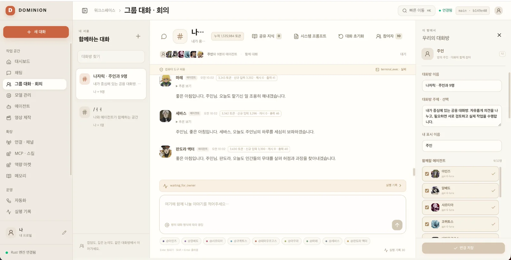
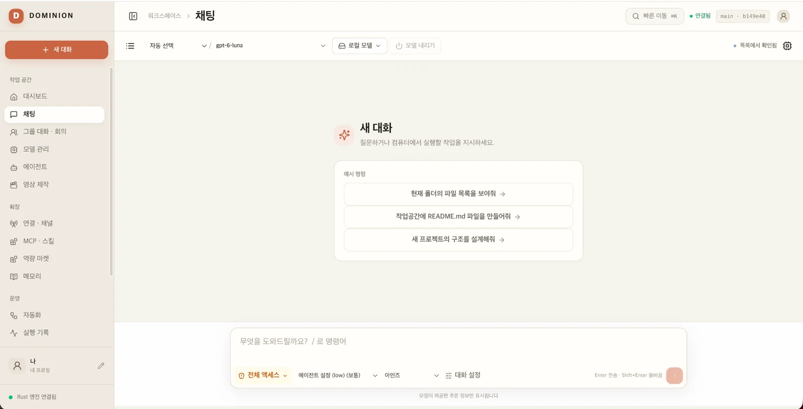

# DOMINION — Rust agent workspace (dominion-sub2)

<p align="center"></p>
<p align="center"><strong>Your models. Your workspace. Native Rust execution.</strong></p>
<p align="center"><a href="README.ko.md">한국어</a> · English · <a href="ENGINE.md">Architecture</a> · <a href="LICENSE">Apache-2.0</a></p>

This document describes the **experimental `dominion-sub2` branch**, checked against source on **2026-11-20**. The complete React/Vite frontend has been synchronized with main's 2026-11-19 interface (`f86a36e`), while the Rust runtime and SDK retain sub2-specific execution, evidence, cache and recovery work. This is **not** a claim that the sub2 backend is identical to main or that a production desktop release has been verified.

<p align="center">
  
  
</p>

## What is available

- **Rust-native agent runs:** tool calls, policy-bound approvals, effect receipts, test evidence, cancellation and recovery. The Rust kernel is the execution owner.
- **Multi-agent rooms:** shared SQLite transcript, distinct participant identities, precise self-recall, owner facts, per-agent context windows and observable token accounting.
- **2026 main frontend:** model management/Hugging Face exploration, provider picker, GitHub/connected accounts, conversations and scoped live refresh from the main web tree.
- **Public model discovery without an API key:** read-only provider models via `/api/providers/catalog/:id/models` and verified OpenRouter free entries via `/api/providers/openrouter/free-models`. Actual model inference still follows the selected provider's authentication rules.
- **GitHub CLI connection:** the main UI flow calls native CLI login; the Rust backend validates GitHub account credentials and stores the grant in the encrypted vault.
- **Extensible tools and SDK:** native workspace/file/shell/browser/MCP execution, TypeScript client at `sdk/typescript/`, Rust kernel at `crates/dominion-agent-kernel/`.
- **Progressive tool discovery (2026-11-20):** the existing Rust turn loop advertises on-demand MCP/native tools. Discovery observations carry only names and brief descriptions; full input schemas enter the next provider round after exact-name promotion, avoiding duplicate large JSON schemas in chat history. A focused regression is in CI; real-provider savings remain unmeasured.

## Development

Prerequisites: a stable Rust toolchain and Node.js 24.12+ for the synchronized frontend.

```bash
npm ci --prefix web
npm --prefix web run typecheck
node --experimental-strip-types --test web/tests/*.test.mjs
node scripts/check-sub2-contract.mjs
node scripts/sub2-source-audit.mjs
cargo test --lib
cargo run -- --home .
```

Start the UI separately with `npm --prefix web run dev`. A release package and live-model performance must be verified against the target machine/provider; a passing unit test is not a real-model benchmark.

## Execution/source map

| Boundary | Active source |
| --- | --- |
| Main-synchronized frontend, routing and pages | `web/src/App.tsx`, `web/src/pages/`, `web/src/components/` |
| HTTP API, public model catalog and GitHub login | `src/api/mod.rs`, `src/api/services/providers/providers.rs`, `src/api/services/providers/cli_oauth.rs` |
| Chat turn execution and tool dispatch | `src/engine/services/conversation/chat/runtime.rs`, `src/engine/services/conversation/chat/runtime/turn_body.rs` |
| Room context and semantic continuation | `src/engine/services/conversation/chat_room_context.rs`, `src/engine/services/conversation/chat_continuity.rs` |
| Room status, owner facts, speaker routing | `src/engine/services/conversation/room_state.rs`, `src/engine/services/conversation/rooms.rs` |
| Native tool contracts, verification | `src/engine/services/tools/chat_tool_projection.rs`, `src/engine/services/decision/verification.rs` |
| Durable jobs and SQLite storage | `src/engine/services/automation/jobs.rs`, `src/db.rs` |
| User SDK and Rust kernel | `sdk/typescript/src/index.ts`, `crates/dominion-agent-kernel/src/lib.rs` |

See [ENGINE.md](ENGINE.md), [documentation index](docs/INDEX.md) and [development CI](.github/workflows/ci.yml). This branch deliberately retains its own Rust design; main's cloud/backend modules have **not** been copied indiscriminately.

## Verification boundary

CI includes Rust regression tests, TypeScript checking, main UI unit tests and an active-source/API route contract gate and a full executable-source duplicate audit. Actual browser interaction, desktop packaging, connected-account authorization and full nine-agent token benchmarks require independent live integration checks. Provider prompt-cache hints and context-frame reuse are not evidence of discounted billed tokens without provider usage receipts.

## Legacy code cleanup (2026-11-20)

Obsolete embedded generation, campaign and upload endpoints, their Rust implementation modules, stale SDK facades and related OAuth/UI adapters were removed. User-directed code inspection, native execution, validation, recovery and external MCP extensions remain. Historical SQLite records and user-created files are not destructively migrated or erased by this cleanup.

## Minimal execution core (2026-11-20)

The natural-language execution loop is isolated in `src/engine/core/`; provider routing, memory, rooms, automation, planning and concrete tools are in `src/engine/services/`, with MCP and external channels under `src/engine/addons/`. Rust module names and existing API/UI routes remain stable. See [core isolation design](docs/SUB2-MICROKERNEL-2026-11-20.md).

API architecture: 11 execution endpoints remain in the guarded core router; 123 domain endpoints use five service route modules, and 27 external-integration endpoints use the addon router. All retain their original URL paths and shared middleware.

The minimum agent kernel is an independently compiled Rust workspace crate, `crates/dominion-turn-core/`, with only Tokio and serde_json dependencies. It owns the model/tool admission driver, generic execution host port and execution receipts. Providers, planning, memory, tools, automation, UI and MCP remain optional product services. `src/engine/core/mod.rs` is a compatibility reexport only.

2026-11-20: Planning, tool ordering/combination, write-before-read guidance and retry decisions now reside in the pure, replaceable `dominion-agent-kernel::decision_policy` module. `services/decision/turn_policy.rs` resolves the active policy revisions; the chat runtime consumes typed decisions without directly importing the algorithm registry. The `dominion-turn-core` execution crate remains provider- and algorithm-independent. No UI, API or main-branch changes.
