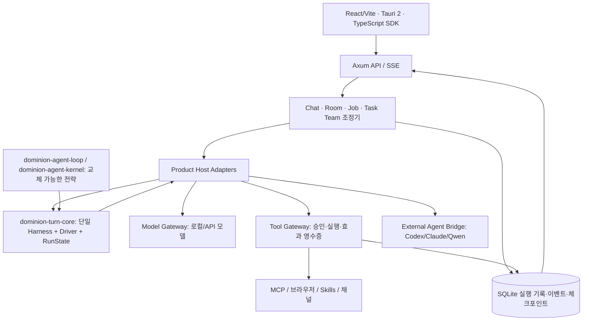

# DOMINION sub2 — 실행 아키텍처 정본 (2026-11-21)

> 범위: `dominion-sub2` 브랜치에서 **실제 소스와 저장소 계약**에 맞게 정리한 구조입니다. 다른 브랜치를 변경하거나 새 UI 메뉴·별도 런타임을 만드는 설계가 아닙니다. 본 문서가 기능의 실기기·실모델 운영 검증까지 보증하지는 않습니다.

## 1. 결정 — 1개 실행 경로, 3개 책임 계층

**Core와 Strategy를 물리적으로 합치지 않습니다.** `dominion-turn-core`는 요청/라운드/도구 배치 승인/공통 상태 의미를 소유하고, 전략은 원하는 행동을 제안합니다. 실제 파일 변경·토큰 비용·상호작용 권한·저장소 접근은 제품 Host가 소유합니다. 같은 Rust 제품 바이너리 안에서 조합하며 별도 마이크로서비스는 필수가 아닙니다.

| 책임 | 실제 소스 | 교체 여부 |
|---|---|---|
| 순수 실행 Core / Harness | `crates/dominion-turn-core/src/{agent_loop,driver,run_state}.rs` | 필수 |
| 선택적 실행 전략 | `crates/dominion-agent-loop/src/lib.rs`, `crates/dominion-agent-kernel/src/decision_policy.rs` | 교체 가능 |
| 전략 설정·활성 정책 | `src/engine/services/decision/turn_policy.rs` | 설정 가능 |
| 제품 조립 / 실행 포트 | `src/engine/mod.rs`, `src/engine/services/conversation/chat/` | Rust 호스트 |
| 모델 게이트웨이 | `src/engine/services/providers/gateway.rs` | 모델/엔드포인트 어댑터 |
| 실제 도구 게이트웨이 | `src/engine/services/tools/tools.rs`, `src/engine/services/operations/effect.rs` | 정책·실행 책임 필수 |
| 선택적 외부 연동 | `src/engine/addons/`, `src/api/addons.rs` | 선택적 |
| 영속 상태/이벤트 | `src/db.rs`, `src/events.rs` | 단일 사실 원천 |
| 단말 및 SDK | `web/`, `src-tauri/`, `sdk/typescript/` | 동일 Axum HTTP/SSE 사용 |

## 2. 단일 실행 계약

1. **Ingress**: 사용자/SDK/채널 요청은 제품 Host에서 run/session/owner identity를 검증합니다.
2. **Strategy**: 계획·컨텍스트·모델 선택은 정책 계층에서 결정하며 도구 권한을 직접 발급하지 않습니다.
3. **Model**: `Harness::request_model`이 Driver의 라운드 제한을 집행합니다. Gateway는 로컬/API 모델별 기능 불지원과 대체 경로를 별도 판단합니다.
4. **Proposal**: `Harness::prepare_response`는 모델이 실제 응답한 도구 ID와 호출 수를 동결합니다. 빈 ID는 호스트에서 한 번만 부여하며 중복 ID는 거부합니다.
5. **Admission**: `Harness::admit_prepared`가 **현재 공개한 도구 목록**, 도구 활성화, 요청별 호출 한도를 배치 전체에 적용합니다.
6. **Effect**: 승인·workspace lock·SQLite Writer lease를 거친 도구 실행만 실제 파일/외부 효과를 수행합니다. 영수증은 `execution_operation`에 저장합니다.
7. **Observation**: 도구의 성공·실패·결과 불명을 구분합니다. 불명확한 변경 결과는 완료로 승격하거나 자동 중복 실행하지 않습니다.
8. **Finalization**: 검증된 실행 결과와 최종 답변은 Host의 저장 절차를 거쳐 기존 Run/Event 계약으로 투영합니다.

`dominion-agent-loop::run`은 독립 모델/도구 루프가 아니라 `dominion-turn-core::agent_loop::Harness::drive_ports`를 호출하는 SDK 호환 포트입니다. 제품 Chat은 같은 Harness의 라운드/승인 단계를 사용하되 스트리밍·DB/도구 스케줄링은 Host 어댑터에 둡니다. ProgramIR의 순수 도구 DAG/검증 절차는 별도 제품 서비스이며 **모델 제공자 실행 루프를 새로 만들면 안 됩니다.**

## 3. Room Chat과 Task Team은 한 가지 기능이 아닙니다

실제 참가자별 지속 읽기 커서의 소유 코드는 `src/engine/services/conversation/room_state.rs`이며, 방의 작업 관측판은 `src/engine/services/conversation/room_workboard.rs`입니다.

| 시스템 | 소유 상태 | 동작 |
|---|---|---|
| Room Chat | `rooms.rs`, `room_state.rs`, `room_workboard.rs` | 공통 원문·참가자별 읽기 커서·발언자 라우팅·협업 관측 |
| 병렬 Room 조사 | `room_parallel.rs` | 읽기 전용으로 제한한 독립 참가자 세션, 최대 4개 동시 모델 호출 |
| Task Team | `task_team.rs`, `runtime_program.rs`, `task_team_work.rs` | `dependsOn` DAG, 준비된 읽기 파동 병렬화, Writer/Delegate 독점 실행, 작업 증거 병합 |

그룹 메시지와 Task Team 작업 모두 같은 Chat/Harness와 영속 이벤트를 사용하지만, 발언권/읽기 커서와 작업 DAG/파일 변경 임대는 별개의 조정기에서 소유합니다.

**Task Team 불변조건 (2026-11-21 강화):** Worker는 원본 `executionId`, `sessionId`, `programRevision`, `teamNodeId`, `nodeId`, `agentId`에 귀속됩니다. SQLite IMMEDIATE 트랜잭션에서 **부모 실행이 살아 있는지 + 자식 상태가 기대값인지** 함께 확인한 후에만 재배정·선점·결과 확정이 가능합니다. 취소/중단된 부모에 대한 늦은 성공 영수증으로 자식을 완료 처리하지 않습니다. `onFailure: continue`로 실패가 관측된 경우는 계속할 수 있으나 그 실패를 성공 검증으로 기록하지 않습니다.

## 4. 도구와 Workspace Writer 단일 경계

- `workspace_write`, `workspace_replace`, `workspace_replace_range`, `workspace_apply_patch`, `shell_exec`, `terminal_exec`, `external_harness_run`은 동일 작업 공간의 변경 가능 자원으로 취급합니다.
- `file_write`의 **절대 경로가 해당 작업 공간 안으로 정규화되면** 똑같은 workspace Writer 잠금/SQLite 임대를 받습니다. 외부 절대 경로는 별도 외부 Writer 범위에 귀속합니다. 해석 불가 경로도 락 없이 진행시키지 않습니다.
- 모델의 `readOnly` 선언은 권한 증거가 아니며, Task Team 병렬화는 네이티브 `safe_to_overlap` 목록에만 의존합니다.
- 외부 Codex/Claude/Qwen 실행기는 Model Gateway의 `ModelPort`가 아니라 별도 Worker/Bridge입니다. 외부 런타임의 내부 도구 권한을 DOMINION이 모두 소유한다고 가정하지 않습니다.

## 5. Run/Event/SDK 공통 의미

- Run 상태: `queued`, `running`, `completed`, `failed`, `cancelled`, `interrupted`, `needs_review`, `skipped`.
- SQLite `event_log`가 단조 증가 `seq`를 관리합니다. 실제 Run 기록에서 만든 `run_state` 버전 1 이벤트는 `eventSeq == seq`이며 `runId`, `runKind`, nullable `sourceMessageId`, nullable `agentId`를 포함합니다.
- Task Team Worker 이벤트에는 `parentRunId`·`teamNodeId`·`nodeId`·`dependsOn`·`evidenceStatus`를 추가합니다. TypeScript SDK `runEvents()`는 동일 SSE 스트림을 읽고 계약 버전/커서를 검사합니다.
- 실행 `phase`는 Core에서 정의한 상태 전이만 허용합니다. 알 수 없는 phase 문자열을 임의의 실패/성공 영수증으로 덮어쓰지 않습니다.

## 6. 2026년 공개 시스템과 설계 연결

- [OpenAI Codex App Server](https://openai.com/index/unlocking-the-codex-harness/): 실행 주체와 UI 프로토콜·thread 상태를 분리. DOMINION은 Axum/SSE와 Rust Core를 유지합니다.
- [Qwen Code 2026-10-05 multi-agent](https://github.com/QwenLM/qwen-code/blob/main/docs/design/2026-10-05-session-multi-agent.md): 별도 에이전트 세션·영속 메시지·실행 소유권을 명시. DOMINION은 Room Cursor와 Task Team 결과를 분리합니다.
- [Hermes Bot Mode](https://github.com/NousResearch/hermes-agent/blob/main/website/docs/user-guide/bot-mode.md): 대화방/게이트웨이/개별 Bot 영속 세션. DOMINION은 그룹 발언과 실제 도구 변경의 소유권을 구별합니다.
- [AgentScope v2 release notes](https://github.com/agentscope-ai-java/agentscope-java/blob/master/docs/v2/en/docs/others/release-notes.md): HarnessAgent의 middleware/인프라 계층 분리. DOMINION은 필수 Core와 선택적 서비스/전략 경계를 고정합니다.

## 7. 구현 검증 대 검증 예정

**소스와 CI 검증 범위:** `cargo test --locked -p dominion-turn-core --lib`, `cargo test --locked -p dominion-agent-loop --lib`, `cargo test --lib engine::task_team_work::tests`, `cargo test --lib engine::resource_lock::tests`, `node --test scripts/sub2-architecture-contract.test.mjs`, `node --test scripts/sub2-core-boundary.test.mjs`, TypeScript 검사. CI는 전체 릴리스/설치 프로그램 빌드를 대신하지 않습니다.

**실환경에서 별도 검증할 항목:** 강제 종료 후 실제 외부 변경의 중복 방지, 100턴 이상 실모델 Room 품질·원가, Codex/Claude/Qwen 실연결·승인 전달, Windows/macOS Tauri 설치, 실제 사용자 계정·결제, 다중 프로세스 환경에서 외부 파일/셸의 모든 잠재적 변경 자원. 이 목록은 소스 미구현을 뜻하는 것이 아니라 **통합/운영 완성의 검증 경계**입니다.

원칙: 새 메뉴·새 HTTP 서버·새 병렬 모델 루프를 만들지 말고, 먼저 기존 실행 계약을 재사용하십시오.

## 8. 실제 구현 연결 — Lead Team, Bot Room, Endpoint Model, SDK (2026-11-21)

이 절은 설계 제안이 아니라 현재 `dominion-sub2` 브랜치에서 새로 연결된 실제 실행 코드의 범위를 기록합니다.

### 자율 Lead/Worker DAG

- `src/engine/services/tools/tools_team.rs`는 `team_workers`, `team_execute`, `team_status`의 실제 서비스입니다.
- Lead는 등록된 Agent ID를 먼저 검색하고, 최대 8개의 노드·`dependsOn`·`readOnly`·`successCriteria`를 포함하는 작업 DAG를 모델 도구 호출로 제출합니다.
- 읽기 Worker는 4개까지 같은 파동에 배치하며 쓰기·외부 위임은 독점 파동을 사용합니다. 실제 Worker는 별도 모델 루프가 아니라 기존 native `delegate`와 `jobs::enqueue`를 호출합니다.
- 팀·멤버 상태는 각각 `managed_team`, `managed_team_task`에 저장됩니다. 결정적 작업 ID, 자식 Job ID, 실제 완료 상태를 재조회하며 끊긴 실행은 기존 팀 ID로 재개합니다.
- 선행 Worker의 완료된 실제 Job 내용만 후속 Worker 프롬프트에 출처 ID와 함께 삽입합니다. 기록이 애매하면 새로운 Worker를 임의 생성하지 않고 `needs_review`로 보존합니다.
- 명시한 `successCriteria`는 기존 `verification::validate_criteria`를 통해 검증한 다음 하위 Job `input.successCriteria`로 전달하여 native verifier가 평가합니다.

### 영속 Bot Room 및 4홉 전달

- `src/engine/services/tools/tools_room_peer.rs`는 `room_peer_send`, `room_peer_inbox`를 구현합니다.
- 실제 등록된 방 참여자만 서로 메시지를 보낼 수 있습니다. SQLite `room_peer_mail`은 발신자·수신자·실행·원문·답장 참조·홉 수·큐/전달 상태를 보존합니다.
- 다음 수신자의 실제 Room 모델 호출에 `room_state::unread_for`가 자기에게 지정된 메일만 삽입합니다. 응답이 영속 저장된 뒤 `acknowledge_read`가 **모델 호출 전에 관측한** 메일만 전달 완료로 표시합니다.
- 4번째 홉을 거부하며 메일 발송만으로 다른 봇을 자동 호출하지 않습니다.

### 엔드포인트별 기능 및 외부 실행기

- `gateway::negotiate_capabilities_for_endpoint`는 `endpointCapabilities[endpoint][model]` → 모델 기본값 → 제공자 기본값으로 기능을 선택합니다. 도구·추론·비전·병렬 도구·스트리밍·캐시·컨텍스트·출력 한도를 근거와 함께 기록합니다.
- `chat/runtime/turn_body.rs`는 실제 응답한 로컬/API 엔드포인트를 기록합니다.
- `tools_external_harness.rs`는 외부 Codex/Claude/Qwen 실행기 세션을 owner·agent·workspace 범위로만 조회하는 `external_harness_sessions`를 구현합니다. 외부 인증·실행기 내부 승인은 실제 설치된 제공자가 책임집니다.

### 동일한 이벤트·SDK

- `dominion-turn-core::run_state::RunEvent`, `src/events.rs`, `sdk/typescript/src/index.ts`가 `managed_team` 및 `managed_team_task`를 기존 `run_state`/SSE `seq`에 통합합니다.
- 내부 `workerJobId`, `parentRunId`, `verified`, `dependsOn`, `nodeId`는 저장된 실행 원문에서 투영하며 가짜 완료 메시지로 만들어 내지 않습니다.

### 범위

이번 구현은 새 제품 메뉴 또는 별도 서버를 만들지 않았습니다. 실제 모델을 이용한 장시간 비용·품질 측정, 외부 CLI 계정·승인 브리지의 실환경 연결, OS별 Tauri 패키지 검증은 릴리스 전에 별도로 필요합니다. 설계 P3의 분산 Gateway·원격 Worker는 원문에서 **실제 다중 기기 요구 시 도입**하도록 명시한 조건부 단계입니다.

## 9. P3 실행: 분산 Rust Gateway + 원격 Worker (2026-11-21)

P3 원문은 "실제 다중 기기 요구가 생길 때 도입"하는 조건부 단계였으나, 현재 브랜치에서는 사용자의 명시적인 구현 요청으로 실행 코드를 추가했습니다. 실제 기기·계정 연결의 검증과 구현 사실은 구분합니다.

### 소스 구현

- src/remote.rs: 별도 옵트인 Remote-only Axum 리스너, 32자 이상 클러스터 토큰 인증, 등록·heartbeat·claim·renew·settle, SQLite CAS 임대, 소유자/epoch fencing, 불확실한 결과 needs_review
- src/remote_worker.rs: inbound 포트가 없는 outbound Rust CLI, 로컬 네이티브 Job/Harness 재사용, readOnly/Writer 허용 범위, 재접속 시 고정 Job ID, 완료 영수증 송신
- src/engine/services/tools/tools_team.rs: Lead의 실제 원격 노드 검색 및 remoteWorkerId가 지정된 Team DAG 실행, 결과·검증 상태·후속 Worker 출처 전달
- src/bootstrap.rs: 기존 데스크톱 HTTP API와 원격 전용 리스너 분리, remote-worker 실행 모드
- crates/dominion-turn-core/src/run_state.rs, src/events.rs, sdk/typescript/src/index.ts: remote_task의 typed RunEvent, 단조 증가 SSE seq, Worker/lease/evidence metadata

### 실행 구성

자세한 배포 설정: [P3 Distributed Rust Workers](SUB2-P3-DISTRIBUTED-RUST-WORKERS-2026-11-21.md).

리더는 기존 Rust GUI/API/Harness를 유지합니다. 같은 바이너리의 별도 remote-only listener는 명시적으로 설정했을 때만 활성화됩니다. 각 원격 PC는 로컬 모델·API·파일 자원과 정상 Rust Job 엔진을 사용하면서 수신 포트 없이 리더의 분산 작업을 처리합니다.

임대 만료, 다른 epoch 재등록, 불확실한 원격 파일 변경은 자동 중복 위임하지 않습니다. 원격 Worker가 결과를 반환하더라도 코디네이터의 파일이 저절로 수정된 것으로 간주하지 않으며, 진짜 공유 저장소 동기화에는 명시적 Git/산출물 전달 계약이 필요합니다.

### 검증 경계

실제 루프백 HTTP(TCP)+SQLite 테스트, Rust lease/epoch/cancel 테스트, SDK typed SSE/구조 계약 테스트를 CI에 포함했습니다. 서로 다른 물리 컴퓨터, 실제 네트워크 복구, 원격 모델 인증, 비공개 터널, OS 설치 프로그램은 별도의 운영 E2E 검증 대상입니다. 클라우드 모델/계정 과금용 Cloudflare Gateway와 원격 실행 제어면은 동일한 기능으로 취급하지 않습니다.
